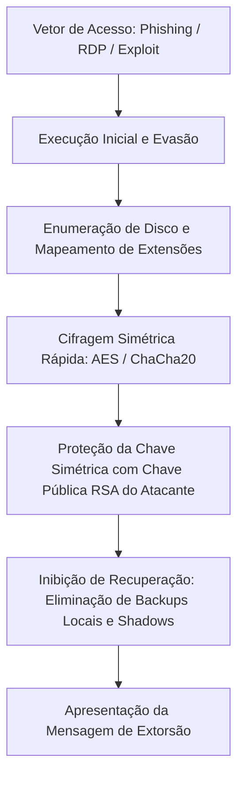
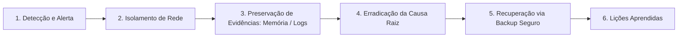

<div align="center">

# 🛡️ Análise Defensiva de Ameaças: Ransomware e Keyloggers
### Engenharia de Detecção, Telemetria e Resposta a Incidentes

[](https://www.dio.me/)
[](https://attack.mitre.org/)
[](https://www.python.org/)
[](#)

<p align="center">
  <b>Projeto prático e analítico desenvolvido para o desafio da Digital Innovation One (DIO).</b><br>
  Compreensão do ciclo de vida de malwares, engenharia de detecção com YARA e Sysmon, monitoramento de integridade em Python e arquitetura de defesa em profundidade.
</p>

</div>

---

## 📌 Sumário
- [1. Visão Geral do Desafio](#1-visão-geral-do-desafio)
- [2. Mapeamento no MITRE ATT&CK](#2-mapeamento-no-mitre-attck)
- [3. Análise Teórica das Ameaças](#3-análise-teórica-das-ameaças)
  - [3.1 Anatomia e Ciclo de Vida do Ransomware](#31-anatomia-e-ciclo-de-vida-do-ransomware)
  - [3.2 Anatomia e Funcionamento de Keyloggers](#32-anatomia-e-funcionamento-de-keyloggers)
- [4. Ferramenta Defensiva: Monitor de Integridade de Arquivos (FIM)](#4-ferramenta-defensiva-monitor-de-integridade-de-arquivos-fim)
- [5. Engenharia de Detecção](#5-engenharia-de-detecção)
  - [5.1 Regras YARA](#51-regras-yara)
  - [5.2 Telemetria do Windows com Sysmon](#52-telemetria-do-windows-com-sysmon)
- [6. Arquitetura de Defesa em Profundidade](#6-arquitetura-de-defesa-em-profundidade)
- [7. Guia de Resposta a Incidentes (NIST SP 800-61)](#7-guia-de-resposta-a-incidentes-nist-sp-800-61)
- [8. Estrutura dos Arquivos](#8-estrutura-dos-arquivos)
- [9. Referências](#9-referências)

---

## 1. Visão Geral do Desafio

Este módulo aborda o estudo conceitual e a implementação de controles defensivos contra duas das classes de malware mais prevalentes no cenário cibernético moderno: **Ransomware** (sequestro e indisponibilização de dados) e **Keyloggers** (espionagem e captura de credenciais).

Conforme as diretrizes pedagógicas da DIO, este projeto documenta os princípios de funcionamento dessas ameaças e desenvolve **soluções de detecção, auditoria e resiliência** voltadas para a prática de Blue Team e centros de operações de segurança (SOC).

---

## 2. Mapeamento no MITRE ATT&CK

A análise estruturada das técnicas utilizadas por operadores dessas ameaças permite correlacionar eventos e desenhar defesas direcionadas:

| ID da Técnica | Nome da Técnica | Tática | Descrição Operacional |
| :--- | :--- | :--- | :--- |
| **[T1486](https://attack.mitre.org/techniques/T1486/)** | Data Encrypted for Impact | Impact | Cifragem de arquivos locais ou remotos para impedir acesso aos dados operacionais. |
| **[T1490](https://attack.mitre.org/techniques/T1490/)** | Inhibit System Recovery | Impact | Exclusão de cópias de sombra de volume (`vssadmin delete shadows`) e pontos de restauração. |
| **[T1056.001](https://attack.mitre.org/techniques/T1056/001/)** | Input Capture: Keylogging | Credential Access / Collection | Interceptação de eventos de teclado via ganchos de API do sistema operacional. |
| **[T1041](https://attack.mitre.org/techniques/T1041/)** | Exfiltration Over C2 Channel | Exfiltration | Envio dos dados capturados por canais não autorizados (ex: SMTP, HTTP/S). |
| **[T1059.006](https://attack.mitre.org/techniques/T1059/006/)** | Command and Scripting: Python | Execution | Utilização de interpretadores instalados para executar rotinas automatizadas. |

---

## 3. Análise Teórica das Ameaças

### 3.1 Anatomia e Ciclo de Vida do Ransomware

O ransomware moderno utiliza uma **arquitetura híbrida de criptografia**:



1. **Cifragem de Alta Performance**: Utiliza-se criptografia simétrica (como AES ou Fernet/HMAC) para processar gigabytes de dados com baixo consumo de tempo de CPU.
2. **Envelope Criptográfico**: A chave simétrica é então cifrada com uma chave pública assimétrica (RSA-2048/4096) controlada externamente. Sem a chave privada correspondente, a recuperação matemática é inviável.
3. **Ponto Crítico de Defesa**: A detecção precoce deve ocorrer no momento das operações massivas de I/O de disco (*File System Operations*) e na tentativa de comunicação externa.

---

### 3.2 Anatomia e Funcionamento de Keyloggers

Keyloggers operam monitorando eventos de hardware de entrada. Em ambientes Windows e Linux, as implementações mais comuns exploram:

- **Hooks de API de Usuário (`SetWindowsHookEx`)**: Registra uma rotina de callback (`WH_KEYBOARD_LL`) para receber notificações globais de teclas digitadas.
- **Polling de Estado (`GetAsyncKeyState`)**: Consulta periodicamente o estado de cada tecla.
- **Acesso a Dispositivos (`/dev/input/event*`)**: Em sistemas Unix-like, leitura direta dos buffers de evento quando executado com privilégios elevados.

A mitigação técnica consiste no princípio de **Zero Trust**, uso de teclados virtuais com proteção contra captura de tela/hook, autenticação multifator baseada em tokens físicos (FIDO2/WebAuthn) e bloqueio de bibliotecas de hooking por agentes de EDR.

---

## 4. Ferramenta Defensiva: Monitor de Integridade de Arquivos (FIM)

Como exercício prático em Python voltado para a defesa, implementou-se o script [`scripts/fim_defensivo.py`](./scripts/fim_defensivo.py).

### Como o FIM combate anomalias de disco:
1. **Catalogação de Baseline**: Gera assinaturas criptográficas SHA-256 de todos os arquivos de um diretório monitorado.
2. **Auditoria em Tempo Real / Periódica**: Recalcula os hashes e emite alertas visuais imediatos ao detectar:
   - Modificações não autorizadas em arquivos legítimos (indicador de alteração ou cifragem indevida).
   - Inserção de novos artefatos suspeitos (como notas de resgate ou scripts executáveis).
   - Exclusão inesperada de arquivos de sistema.

```bash
# Gerando a linha de base (primeira execução)
python scripts/fim_defensivo.py ./meu_diretorio

# Executando a auditoria de integridade
python scripts/fim_defensivo.py ./meu_diretorio
```

---

## 5. Engenharia de Detecção

### 5.1 Regras YARA
Disponibilizadas no arquivo [`rules/yara_detect.yar`](./rules/yara_detect.yar), as regras abaixo permitem que ferramentas de varredura identifiquem artefatos suspeitos em disco ou memória:

- **`Detect_Suspicious_Keyboard_Hooking`**: Identifica chamadas de API (`SetWindowsHookEx`, `GetAsyncKeyState`) e módulos Python (`pynput.keyboard`) comumente atrelados a rotinas de captura de digitação.
- **`Detect_Mass_File_Encryption_Indicators`**: Identifica strings de extorsão combinadas com chamadas de bibliotecas de criptografia e iteração de diretórios em lote.

### 5.2 Telemetria do Windows com Sysmon
O arquivo [`detection/sysmon_rules_example.xml`](./detection/sysmon_rules_example.xml) demonstra a configuração de telemetria avançada no Windows:
- **Event ID 1 (Process Create)**: Monitora a execução de interpretadores (`python.exe`, `powershell.exe`) a partir de pastas temporárias (`AppData\Local\Temp`).
- **Event ID 11 (File Create)**: Registra a criação de arquivos com padrões característicos de notas de resgate.

---

## 6. Arquitetura de Defesa em Profundidade

Para neutralizar de forma sustentável ameaças de ransomware e keyloggers, uma organização deve implementar defesas em camadas:

```
┌────────────────────────────────────────────────────────┐
│ 1. Camada Humana: Conscientização Anti-Phishing       │
├────────────────────────────────────────────────────────┤
│ 2. Camada de Endpoint: AppLocker / WDAC & EDR          │
├────────────────────────────────────────────────────────┤
│ 3. Camada de Identidade: MFA FIDO2 e Menor Privilégio  │
├────────────────────────────────────────────────────────┤
│ 4. Camada de Dados: Backup Imutável 3-2-1             │
└────────────────────────────────────────────────────────┘
```

1. **Estratégia de Backup 3-2-1 Imutável**:
   - **3** cópias dos dados críticos.
   - **2** mídias distintas (ex: disco local e armazenamento em nuvem).
   - **1** cópia externa e **completamente imutável** (*Object Lock / WORM - Write Once, Read Many*) ou offline (*air-gapped*).
2. **Application Whitelisting (WDAC / AppLocker)**: Impede a execução arbitrária de binários e scripts não assinados fora de diretórios corporativos protegidos.
3. **MFA Resistente a Phishing**: O uso de chaves FIDO2/WebAuthn impede que credenciais capturadas por keyloggers sejam reutilizadas em acessos corporativos externos.
4. **Segmentação de Rede e Restrição de Protocolos**: Bloqueio de portas de compartilhamento (SMB 445, RDP 3389) entre estações de trabalho de usuários.

---

## 7. Guia de Resposta a Incidentes (NIST SP 800-61)

Em caso de suspeita de infecção, a equipe de segurança deve seguir o fluxo de contenção:



- **Isolamento Imediato**: Desconectar o cabo de rede ou bloquear a porta do switch (evitar desligar a máquina imediatamente se for necessária a coleta forense da memória RAM para extração de chaves voláteis).
- **Revogação de Credenciais**: Reset obrigatório de todas as senhas de contas que estavam ativas no host comprometido.
- **Validação de Integridade**: Certificar que o ponto de restauração do backup é anterior à data de comprometimento inicial.

---

## 8. Estrutura dos Arquivos

```text
├── .gitignore                          # Regras de exclusão do Git
├── README.md                           # Documentação técnica e estudo aprofundado
├── scripts/
│   └── fim_defensivo.py               # Monitor de Integridade de Arquivos em Python
├── rules/
│   └── yara_detect.yar                # Regras YARA de detecção de assinaturas
└── detection/
    └── sysmon_rules_example.xml       # Regras de telemetria do Windows Sysmon
```

---

## 9. Referências
- [MITRE ATT&CK Framework](https://attack.mitre.org/)
- [NIST Special Publication 800-61 Rev. 2 - Computer Security Incident Handling Guide](https://csrc.nist.gov/publications/detail/sp/800-61/rev-2/final)
- [YARA Documentation - The pattern matching swiss knife for malware researchers](https://yara.readthedocs.io/)
- [Microsoft Learn - Sysinternals Sysmon](https://learn.microsoft.com/pt-br/sysinternals/downloads/sysmon)
- [Digital Innovation One (DIO)](https://www.dio.me/)

---
<div align="center">
  <sub>Documentação desenvolvida para fins educacionais e de segurança defensiva na plataforma DIO.</sub>
</div>
